```
INCIDENT   #RT-0001                  PRIORITY  HIGH
UNIT       J. APODACA                STATUS    EN ROUTE → RED TEAM
CALL TYPE  CAREER CHANGE: 911 DISPATCH → OFFENSIVE SECURITY
ASSIGNED   AI RED TEAMING · DETECTION ENGINEERING · FORENSICS
NOTES      Trained to stay calm when everything is on fire.
           Now breaking AI systems on purpose, before someone else does.
```



# Hi, I'm Jocelyn 👋

I work where things go wrong in real time. I'm a **Real Time Crime Center technician**: I fly drones, watch camera feeds, and dig up information that helps officers with active cases. I also work as a 911 dispatcher and communications training officer. Before that I was a telecommunicator on a military installation, where I held a DoD Secret clearance (now inactive).

Now I'm moving that instinct, *find the signal fast and act on it*, into **cybersecurity**. I'm finishing a B.S. in Information & Communication Technology (Cyber Defense), and I'm working toward **red teaming, especially AI red teaming**.

---

### 🔨 What I'm working on

- **Synthetic Defense Platform**, a deepfake detection web app built with a 4-person team for our senior project. I own the **video and face analysis** module: OpenCV and MediaPipe to track faces frame by frame and flag the inconsistencies that synthetic video leaves behind.
- **CompTIA Security+**, exam in January 2027.
- **Hands-on labs** in Kali Linux and Splunk: attacking, then detecting what I just did.

### 📂 Projects

| Project | What it is | Built with |
|---|---|---|
| **Synthetic Defense Platform** *(team repo, private for now)* | Deepfake detection: AI classification, face/video analysis, image forensics (EXIF, ELA) and a combined risk score in one Flask dashboard. My part: video/face analysis. | Python, OpenCV, MediaPipe, PyTorch, Flask |
| [learning_log](https://github.com/jocapodaca/learning_log) | Django web app with user accounts, topics and journal entries. Built while learning Django from *Python Crash Course*. | Python, Django |

### 🧰 Tools I use

- **Languages:** Python · Java
- **Security:** Kali Linux · Splunk · digital forensics · OSINT
- **Systems & cloud:** Linux · Windows Enterprise · Azure
- **Computer vision:** OpenCV · MediaPipe

### 🎯 What I'm looking for

- **Summer 2027 cybersecurity internships**, especially red team or offensive security
- **Remote** security analyst roles (SOC, threat intel, forensics, insider threat), or cleared roles that restart my clearance

If you're building something in AI security and need someone who stays calm when the alerts start firing, that's the kind of team I want to join.
